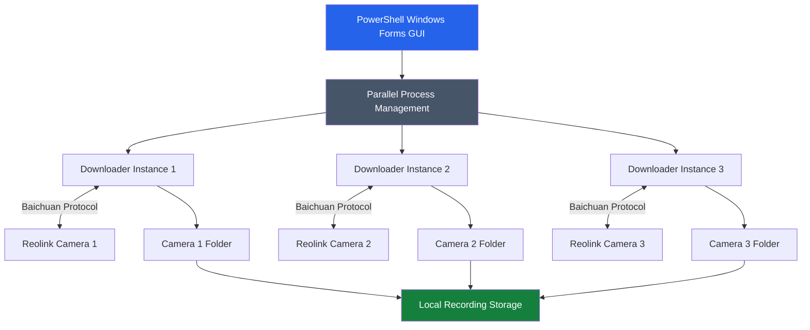

<div align="center">

# Reolink Camera Bulk Downloader GUI

### Multi-camera recording retrieval. Simplified.


**A lightweight, portable Windows utility for downloading historical
recordings from multiple Reolink cameras simultaneously.**

[Overview](#overview) •
[Features](#features) •
[Installation](#installation) •
[Usage](#usage) •
[Architecture](#architecture) •
[Roadmap](#development-roadmap)

</div>

---

## Overview

Retrieving large volumes of historical recordings through Reolink
Client can be a time-consuming and cumbersome process.

**Reolink Camera Bulk Downloader GUI** provides a streamlined
alternative by combining a native Windows graphical interface
with the open-source `reolink-downloader` backend.

Designed with simplicity in mind, the utility allows users to
select multiple cameras, specify a recording date range, and
retrieve existing footage directly from camera SD cards without
manually constructing command-line arguments.

Originally developed to solve a real-world challenge involving
bulk recording retrieval from multiple Reolink RLC-811A cameras.

> [!TIP]
> No separate GUI installation is required. The application
> is distributed as a single portable PowerShell script.

---

<!-- Re-enable once screenshots/application.png is added:
## Application Preview

<div align="center">


*Simultaneous recording retrieval with independent camera monitoring.*

</div>

-->

## Features

| Feature | Description |
| :--- | :--- |
| Parallel Downloads | Retrieve recordings from multiple cameras simultaneously. |
| Camera Selection | Select individual cameras or all configured cameras. |
| Date Range Selection | Download a single day, multiple days, or an entire month. |
| Credential Entry | Masked password input without hardcoded credentials. |
| Destination Selection | Choose where downloaded recordings are stored. |
| Automatic Organization | Separate recordings into camera-specific directories. |
| Activity Monitoring | Independent download activity indicators for each camera. |
| File Monitoring | Live local file counts and storage usage. |
| Activity Logging | View downloader output and error messages in real time. |
| Folder Access | Open individual camera folders directly from the interface. |
| Download Cancellation | Stop active download operations when necessary. |
| Source Preservation | Designed to copy recordings without deleting source footage. |
| Portable Deployment | A single PowerShell script with no separate GUI installer. |

---

## Requirements

### System Requirements

| Component | Requirement |
| :--- | :--- |
| Operating System | Microsoft Windows |
| PowerShell | Windows PowerShell 5.1 |
| GUI Framework | Windows Forms |
| Package Manager | `uv` |
| Download Backend | `reolink-downloader` |
| Network | Direct connectivity to configured cameras |
| Authentication | Valid camera credentials |
| Storage | Sufficient disk space for requested recordings |

### Camera Compatibility

| Camera Model | Status |
| :--- | :--- |
| Reolink RLC-811A | Confirmed working |
| Other Reolink PoE Cameras | Not independently tested |
| Reolink Wi-Fi Cameras | Not independently tested |
| Reolink NVR Systems | Not independently tested |

Compatibility with additional devices depends on the underlying
downloader and installed camera firmware.

---

## Installation

### Step 1 — Install uv

If `uv` is not already installed, install it using:

```powershell
winget install --id=astral-sh.uv -e
```

Close and reopen PowerShell after installation.

Verify that `uv` is available:

```powershell
uv --version
```

### Step 2 — Install the Reolink Downloader

Install the underlying download utility:

```powershell
uv tool install git+https://github.com/deviantintegral/reolink-downloader
```

Verify the installation:

```powershell
reolink-downloader --help
```

If the command is not recognized, refresh the terminal session
and verify that the uv tools directory is included in your PATH.

### Step 3 — Download the GUI

Download `CameraDownloader.ps1` from this repository and place
it in a convenient location.

For example:

```text
C:\Tools\ReolinkDownloader\CameraDownloader.ps1
```

### Step 4 — Configure Your Cameras

Open the PowerShell script in your preferred text editor.

Locate the `$CameraIPs` line near the top of the script and
replace the example addresses with those of your own cameras:

```powershell
$CameraIPs = @('192.168.1.101','192.168.1.102','192.168.1.103')
```

Example camera inventory:

| Camera | IP Address |
| :--- | :--- |
| Camera 1 | 192.168.1.101 |
| Camera 2 | 192.168.1.102 |
| Camera 3 | 192.168.1.103 |

Save the script after updating the configuration.

### Step 5 — Launch the Application

Right-click `CameraDownloader.ps1` and select:

**Run with PowerShell**

Alternatively, launch the application from PowerShell:

```powershell
powershell.exe -NoProfile -STA -File ".\CameraDownloader.ps1"
```

> [!NOTE]
> If Windows blocks the downloaded script, review its contents
> and unblock it if permitted by your organization's security
> policies.
>
> ```powershell
> Unblock-File -Path ".\CameraDownloader.ps1"
> ```

---

## Usage

### Downloading Recordings

1. Launch the application.
2. Select the cameras you want to download recordings from.
3. Select the start date.
4. Select the end date.
5. Enter the camera username and password.
6. Select the destination directory.
7. Click **Download**.
8. Monitor the individual camera activity indicators.
9. Wait for the selected downloads to complete.
10. Open the camera folders to access downloaded recordings.

> [!IMPORTANT]
> Keep the PowerShell application running until all downloads
> have completed. Closing the application may interrupt active
> recording transfers.

### Date Range Examples

| Desired Recordings | Start Date | End Date |
| :--- | :--- | :--- |
| Single Day | 2026-11-01 | 2026-11-01 |
| One Week | 2026-11-01 | 2026-11-07 |
| Entire Month | 2026-11-01 | 2026-11-30 |

The end date is inclusive.

Only recordings still available on the selected cameras can
be retrieved.

### Download Monitoring

Each configured camera has its own:

- Download status.
- Animated activity indicator.
- Local recording file count.
- Local storage usage.
- Destination folder shortcut.
- Camera-specific activity log messages.

This allows users to monitor multiple transfers without waiting
for one camera to finish before starting another.

---

## Recording Organization

Downloaded recordings are automatically separated into
individual directories based on camera IP address.

```text
C:\CameraFTP\
│
├── 192.168.1.101\
│   ├── Recording_001.h265
│   ├── Recording_002.h265
│   └── Recording_003.h265
│
├── 192.168.1.102\
│   ├── Recording_001.h265
│   └── Recording_002.h265
│
└── 192.168.1.103\
    ├── Recording_001.h265
    └── Recording_002.h265
```

The filenames above are illustrative. Actual filenames are
determined by the underlying downloader.

Each camera maintains its own destination folder, preventing
filename collisions between different cameras.

> [!WARNING]
> Overlapping download date ranges may overwrite existing local
> recordings. Duplicate detection and file integrity verification
> are not currently implemented.

---

## Architecture

The application uses a modular architecture that separates
the graphical interface from camera communication and
recording retrieval.



### Application Components

| Component | Responsibility |
| :--- | :--- |
| PowerShell GUI | User interaction, configuration, and visual monitoring. |
| Process Management | Independent downloader execution and monitoring. |
| Reolink Downloader | Camera authentication, recording discovery, and retrieval. |
| Local Storage | Organization and preservation of downloaded recordings. |

Each selected camera operates through an independent downloader
process, allowing simultaneous recording retrieval.

---

## Network Requirements

The download workstation must be able to initiate connections
to the configured Reolink cameras.

Reolink's native Baichuan protocol commonly uses TCP port 9000.

| Protocol | Port | Purpose |
| :--- | :--- | :--- |
| TCP | 9000 | Native Reolink camera communication |

Additional requirements may depend on the camera firmware
and downloader version.

Test native protocol connectivity using PowerShell:

```powershell
Test-NetConnection 192.168.1.101 -Port 9000
```

### Segmented Network Deployment


For enterprise or segmented environments, configure narrowly
scoped firewall policies permitting communication between
the authorized download workstation and the cameras.

> [!IMPORTANT]
> Internet exposure and external port forwarding are not
> required for local camera recording retrieval.

---

## Tested Environment

The application has been used in the following environment:

| Component | Configuration |
| :--- | :--- |
| Camera Model | Reolink RLC-811A PoE |
| Camera Count | 3 |
| Download Mode | Simultaneous |
| Operating Environment | Microsoft Windows |
| PowerShell Version | 5.1 |
| Network Design | Isolated Camera VLAN |
| Firewall | FortiGate |
| Recording Source | Camera SD Cards |
| Destination | Local Workstation Storage |

Simultaneous historical recording retrieval from all three
cameras was demonstrated successfully.

Broader device compatibility and complete archival integrity
have not been independently validated.

---

## Troubleshooting

| Issue | Recommended Action |
| :--- | :--- |
| Downloader not recognized | Verify installation and PATH configuration. |
| Invalid credentials | Verify username, password, and case sensitivity. |
| Unable to connect | Verify camera availability and firewall access. |
| Script execution blocked | Review applicable PowerShell execution policies. |
| Downloads appear stalled | Review the activity log and destination folder. |
| Recording will not play | Verify file format, transfer completion, and player compatibility. |
| Insufficient disk space | Select a destination with additional available storage. |
| Interrupted transfer | Inspect incomplete files before restarting the download. |

### Authentication

The default Reolink administrator username is typically:

```text
admin
```

Username case sensitivity may affect authentication.

### Recording Playback

Downloaded recordings may use raw H.264 or H.265 video formats,
depending on the camera and downloader configuration.

A compatible media player, such as VLC, may be required.

---

## Current Limitations

The current release is designed for manual, on-demand
recording retrieval.

| Limitation | Current Behavior |
| :--- | :--- |
| Scheduling | Downloads must be manually initiated. |
| Camera Inventory | Camera addresses are configured within the script. |
| Authentication | Selected cameras use shared credentials. |
| Progress Reporting | Activity indicators rather than exact completion percentages. |
| Duplicate Detection | Previously downloaded recordings are not automatically skipped. |
| Integrity Verification | File hash and size verification are not implemented. |
| Interrupted Downloads | Incomplete local files may remain. |
| Credential Handling | Credentials are passed to the backend as process arguments. |

> [!CAUTION]
> Masked password entry prevents passwords from being displayed
> in the graphical interface, but does not prevent privileged
> local users from potentially inspecting process arguments.

---

## Development Roadmap

### Phase 1 — Core Functionality

- [x] Portable PowerShell application
- [x] Windows Forms graphical interface
- [x] Multi-camera selection
- [x] Configurable recording date ranges
- [x] Parallel camera downloads
- [x] Camera-specific output directories
- [x] Individual camera activity monitoring
- [x] Live activity logging
- [x] Download cancellation
- [x] Resizable application interface

### Phase 2 — Download Intelligence

- [ ] Accurate per-camera completion percentages
- [ ] Total recording counts
- [ ] Estimated time remaining
- [ ] Download speed reporting
- [ ] Duplicate recording detection
- [ ] File size and hash verification
- [ ] Temporary download files
- [ ] Safe replacement of incomplete recordings
- [ ] Automatic retry and recovery

### Phase 3 — Configuration Management

- [ ] Dynamic camera inventory
- [ ] User-defined camera names
- [ ] Individual camera credentials
- [ ] Persistent application preferences
- [ ] Windows Credential Manager integration
- [ ] Import and export configuration

### Phase 4 — Automation and Integration

- [ ] Scheduled recording downloads
- [ ] Headless command-line operation
- [ ] Windows Task Scheduler integration
- [ ] Automated recording archival
- [ ] Download manifests
- [ ] MCP server integration
- [ ] AI-assisted recording retrieval

---

## Version History

| Version | Description |
| :--- | :--- |
| v3.0.0 | Resizable interface, improved layout, and display scaling. |
| v2.0.0 | Parallel downloads and independent camera monitoring. |
| v1.0.0 | Initial graphical interface and sequential downloading. |

For additional information, see [CHANGELOG.md](CHANGELOG.md).

---

## Contributing

Suggestions, bug reports, and contributions are welcome.

When reporting an issue, please include:

- Camera model.
- Camera firmware version.
- Windows version.
- PowerShell version.
- Downloader version.
- Relevant error messages.
- Steps to reproduce the issue.

> [!WARNING]
> Do not include camera passwords, customer information,
> confidential recordings, or sensitive network details
> in public issue reports.

---

## Acknowledgments

This project provides a graphical interface and process
management layer for the existing open-source
**Reolink Downloader** project.

| Project | Purpose |
| :--- | :--- |
| [reolink-downloader](https://github.com/deviantintegral/reolink-downloader) | Underlying recording retrieval backend |
| [uv](https://github.com/astral-sh/uv) | Python package and environment management |
| Windows Forms | Native Windows graphical interface |
| PowerShell | Application logic and process management |

Credit for the underlying camera communication and recording
retrieval functionality belongs to the original project and
its dependencies.

---

## License

This project is licensed under the GNU General Public License v3.0.
See [LICENSE](LICENSE) for details.

The `reolink-downloader` backend is a separate project distributed
under its own license and is not included in this repository.

---

## Disclaimer

This is an unofficial, independent utility and is not
affiliated with, sponsored by, or endorsed by Reolink.

Use this software only with cameras and recordings that you
are authorized to access.

Always validate downloaded recordings before relying on them
for archival, compliance, or evidence retention purposes.

The application is provided without guarantees of recording
completeness, availability, or compatibility with all devices.

---

<div align="center">

**Built to solve a real-world infrastructure problem.**

*Simple deployment. Parallel downloads. Less manual work.*


</div>
